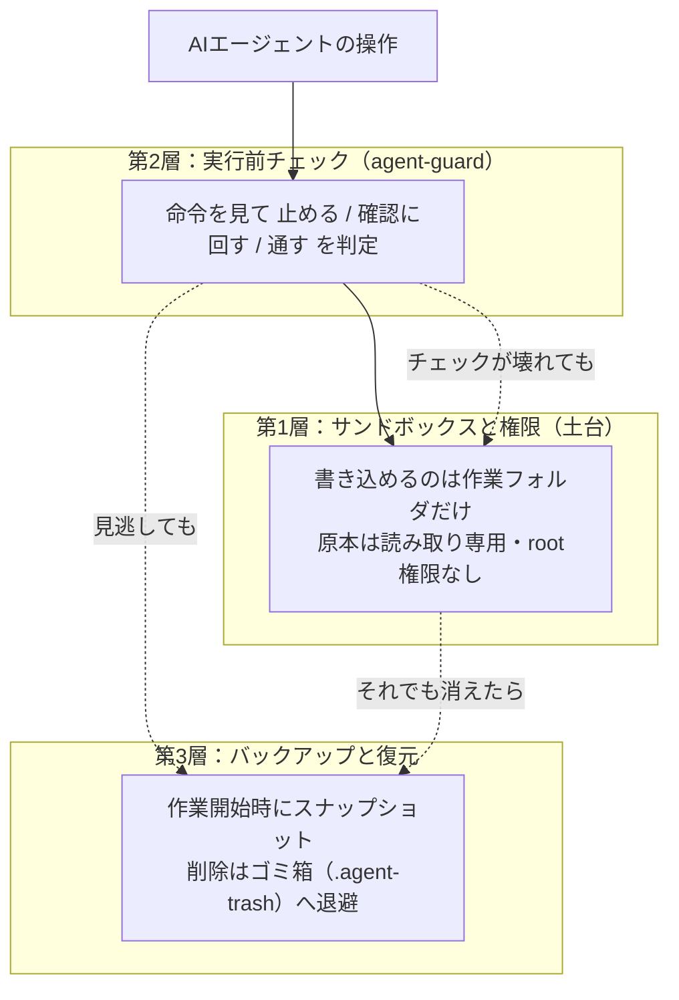
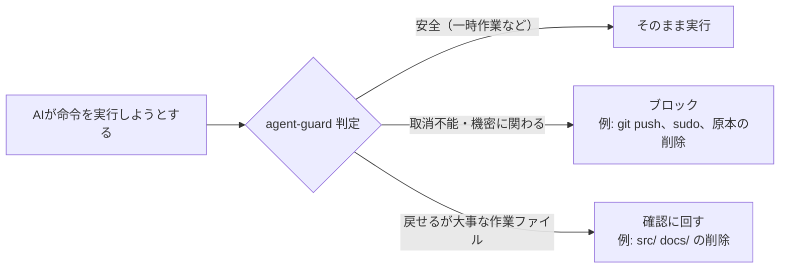
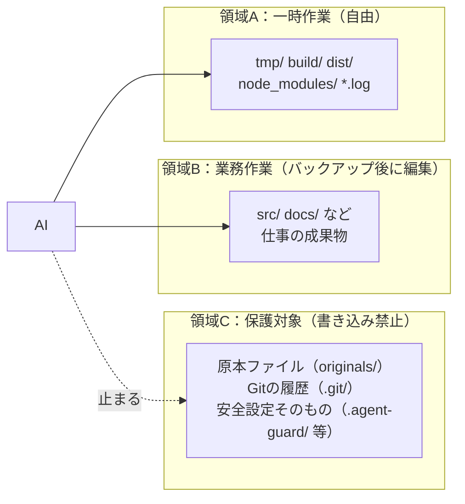

# エージェント・ハーネス初心者スターターキット

Claude Code・Codex・Google Antigravity・OpenCode の4つの「AIコーディングエージェント」を、**非エンジニアが安全に使い始めるための設定一式**です。どのツールでも、コマンド1つでプロジェクトに安全設定を入れられます。

> **いちばん大事な結論**：AIに「何をさせないか」を決めるのが先、ツールの使い方を覚えるのは後です。このキットは **3層の防御**（権限で守る → 実行前に止める → 消えても戻す）を、どのツールでも同じ感覚で使えるようにします。安全チェック（Hook）が壊れたり外されたりしても、重要なデータは守られます（[ラボの結果](#8-ラボの結果で確認したこと)で実証済み）。

対象読者：プログラミングは専門外だが、AIエージェントに社内の作業を任せたい人。必要なもの：Python 3.10以上（Windows / macOS / Linux）。

---

## 目次

1. [防ぎたい事故（このキットの出発点）](#1-防ぎたい事故このキットの出発点)
2. [4原則（判断に迷ったらここに戻る）](#2-4原則判断に迷ったらここに戻る)
3. [3層の防御（Hookだけに頼らない）](#3-3層の防御hookだけに頼らない)
4. [領域A・B・C（フォルダの使い分け）](#4-領域abcフォルダの使い分け)
5. [導入手順（ツール別）](#5-導入手順ツール別)
6. [Hookだけでは守れないこと](#6-hookだけでは守れないこと)
7. [仕様の根拠とツールごとの違い](#7-仕様の根拠とツールごとの違い)
8. [ラボの結果（実機で確認したこと）](#8-ラボの結果で確認したこと)

## 1. 防ぎたい事故（このキットの出発点）

ツールの機能から考えるのではなく、「起きてほしくない事故」から考えます。

| 優先度 | 防ぎたい事故 |
|---|---|
| **最重要** | 重要データの消失（原本ファイル・長期間の仕事の成果が消える）／ 機密情報の漏えい（鍵・パスワード・社外秘が外に出る）／ 社内システムの破壊 |
| **高** | 悪意あるプログラムの実行（ネットから落としたスクリプトの即実行）／ 意図しない大量変更 ／ AIの誤誘導（プロンプトインジェクション：Webページやファイルに仕込まれた指示でAIが騙される） |
| **中** | PC環境の破損（OS設定・アクセス権の変更）／ 無限ループ・資源浪費（プロセスやディスクの暴走） |

## 2. 4原則（判断に迷ったらここに戻る）

- **原則A：守るべきものに触れさせない** — 原本・秘密情報・OS設定は、AIの作業場所の外に置く。許可ではなく**構造**で守る。
- **原則B：戻せる変更はなるべく止めない** — 一時ファイルの削除やビルドでAIをいちいち止めない。止めるのは「取消不能な操作」と「大事なファイル」だけ。
- **原則C：取り返せない操作だけ人が判断する** — 外部への送信、原本の変更、大量削除。確認画面はここにだけ出す。
- **原則D：未知のコードは信用しない** — ネットから落としたものは中身を確認し、実行は隔離環境（コンテナ）で。

## 3. 3層の防御（Hookだけに頼らない）

「AIが危険な命令を実行した」を防ぐ仕組みを3層に重ねます。**どれか1つが壊れても事故にならない**のが完成条件です。



| 層 | 何をする | ツールごとの名前 |
|---|---|---|
| 第1層 | 作業フォルダの外に書けない。原本は読み取り専用 | Claude Code `sandbox` ／ Codex `sandbox_mode` ／ Antigravity サンドボックスプリセット ／ OpenCode はOSの権限とコンテナで |
| 第2層 | 実行前に命令を判定。危険なら止める／人に確認 | 4ツール共通の判定スクリプト **agent-guard**（各ツールのHook機能から呼ぶ） |
| 第3層 | 事故が起きても戻せる | 共通の **checkpoint.py**（スナップショット）と **trash.py**（ゴミ箱退避） |

agent-guard の判定は3種類です。理由は必ず日本語で表示されます（何をする／なぜ／何が失われる／元に戻せるか／安全な代替案）。



## 4. 領域A・B・C（フォルダの使い分け）

「どのフォルダは自由に使ってよくて、どのフォルダは絶対に触らせないか」を3つの領域に分けます。



| 領域 | 例 | AIはどう扱えるか |
|---|---|---|
| **A：一時作業** | `tmp/` `build/` `dist/` `node_modules/` `*.log` | 自由。削除しても確認不要（既定の `policy.json` で変更可能） |
| **B：業務作業** | `src/` `docs/` など仕事のファイル | 編集は自由（作業前バックアップあり）。**削除は人の確認**、またはゴミ箱（`trash.py`）へ退避 |
| **C：保護対象** | 原本、`.git/`、安全設定ファイル、作業フォルダの外すべて | **書き込み・削除はブロック**。原本は作業フォルダの外（読み取り専用）に置くのが前提 |

## 5. 導入手順（ツール別）

共通の準備：

1. Python 3.10以上を入れる（`python --version` で確認）。
2. このリポジトリをダウンロード（`git clone` か GitHubの「Code → Download ZIP」）して展開する。
3. **AIに作業させるフォルダ（作業フォルダ）を決める。** 原本はここに置かず、別の読み取り専用の場所に置く。

そして、使うツールに合わせて1コマンド実行するだけです（複数ツールの併用も可。`--tool all` で全部入ります）。

```bash
# 例：Claude Code の場合
python install.py --project C:/work/my-project --tool claude

# 事前に何が起きるか見たいとき
python install.py --project C:/work/my-project --tool claude --dry-run
```

`install.py` がやること：`guard/` を `<作業フォルダ>/.agent-guard/` へコピーし、ツール設定ファイル（後述の各フォルダ参照）を絶対パス付きで書き込む。**既存ファイルは `--force` がない限り上書きしない**（`--force` 時は旧ファイルを `.bak-日時` に退避）。グローバル設定（`~/.claude` など）は**一切変更しません**。

| ツール | インストール | 詳しい手順 |
|---|---|---|
| Claude Code | `--tool claude` | [claude-code/README.ja.md](claude-code/README.ja.md) |
| Codex | `--tool codex` | [codex/README.ja.md](codex/README.ja.md) |
| Google Antigravity | `--tool antigravity` | [antigravity/README.ja.md](antigravity/README.ja.md) |
| OpenCode | `--tool opencode` | [opencode/README.ja.md](opencode/README.ja.md) |

### ツールごとの重要な違い（先に知っておくこと）

- **Codex はHookから承認画面（ask）を出せません。** 仕様上 `ask` を返すとチェックが「失敗」扱いになり、**操作が止まらずに続行**されてしまいます。そのためこのキットはCodexでは「確認が必要」な操作も `deny`（拒否）にして、AIに日本語で状況を説明させ、**実行は利用者自身が手作業で行う**運用にしています。
- **OpenCode のプラグインも承認画面を出せません。** プラグイン（`.opencode/plugins/agent-guard.js`）は `deny` も `ask` も両方止めて、理由をAIに伝えます。承認はOpenCode本体の `permission` 設定（`opencode.json` の `ask`）が担います。
- **Claude Code と Antigravity はHookから承認画面を出せます**（Claude Code: `ask`、Antigravity: `force_ask`）。

### リポジトリの構成

```
install.py                導入スクリプト（プロジェクトへコピー＆設定）
guard/                    共通の判定エンジン
  agent_guard.py          実行前チェック本体（Python標準ライブラリのみ）
  trash.py                削除の代わりにゴミ箱（.agent-trash/）へ退避・復元
  checkpoint.py           作業前スナップショットと復元
  policy.json             何を危険とみなすかの設定（領域A/B/Cの既定値）
claude-code/ codex/ antigravity/ opencode/   ツール別テンプレート＋README
tests/                    agent_guard の単体テスト（29件）
lab/                      Podmanコンテナで事故を再現する検証ラボ
docs/spec-notes.md        公式ドキュメントで確認した仕様の記録と出典
reports/                  ラボの実行ログと結果
```

## 6. Hookだけでは守れないこと

agent-guard（第2層）は便利ですが、**命令の文字列しか見えない**という限界があります。以下はHookでは防げない例で、第1層と第3層が本当に守る部分です。

| Hookで防げないこと | 例 | 何が守るか |
|---|---|---|
| 命令を経由しない削除 | Pythonスクリプト内の `shutil.rmtree()`、ビルドツールが行う削除 | 第1層：作業フォルダの外は書けない。原本は読み取り専用（実機確認済み：Hookを無視して直接 `rm` してもOSの権限で失敗） |
| Hookそのものの失敗・無効化 | 設定ファイルの削除、`--dangerously-*` 系フラグ | 第1層：安全設定ファイルは領域C（ブロック対象）。guard自体も入力が壊れていれば「止める側」に倒れます（fail closed） |
| 権限昇格後の操作 | root権限でのOS書き換え | 第1層：コンテナにはsudoを入れない、`--cap-drop=all`、`no-new-privileges` |
| 暴走（フォーク爆弾・無限ループ） | プロセス600個の起動 | 第1層：コンテナのリソース上限（`--pids-limit`、メモリ・CPU上限） |
| プロンプトインジェクション | Webページに仕込まれた「秘密を送信せよ」等の指示 | 第2層（外部送信コマンドはブロック）＋第1層（ネット遮断サンドボックス）＋そもそも秘密を作業フォルダに置かない |
| 消した後のトラブル | 誤削除、意図しない大量変更 | 第3層：`checkpoint.py` のスナップショットと `trash.py` の退避で復元 |

**運用の基本**：原本は作業フォルダの外へ。秘密情報はAIに渡さない。未知のコードの実行はコンテナで。この3つは設定より先に効きます。

## 7. 仕様の根拠とツールごとの違い

各ツールのHook・権限・サンドボックスの仕様は、2026-11-06時点の公式ドキュメントで確認した記録を [docs/spec-notes.md](docs/spec-notes.md) に残しています（URL付き）。要点：

| 機能 | Claude Code | Codex | Antigravity | OpenCode |
|---|---|---|---|---|
| 実行前チェック | `PreToolUse` Hook | `PreToolUse` Hook | `PreToolUse` Hook | プラグイン `tool.execute.before` |
| Hookで止める | `deny` | `deny` | `deny` | 例外を投げる |
| Hookで承認画面 | `ask` ◎ | **不可**（askは失敗扱いで続行）→ denyで運用 | `force_ask` ◎ | **不可** → 本体の `permission.ask` と併用 |
| Hookの有効化 | 設定を書けば有効 | プロジェクトの信頼＋`/hooks`での信頼が必要 | 設定を書けば有効 | プラグインを置けば読み込む |
| サンドボックス | あり（Windows本体はWSL2で） | `workspace-write` | プリセット | なし（コンテナ利用を推奨） |

判定エンジン（agent-guard）はPython標準ライブラリだけで動き、Windows / macOS / Linux で共通です。単体テストは `python -m unittest discover -s tests -v` で実行できます。

## 8. ラボの結果（実機で確認したこと）

Podmanコンテナ（隔離環境）で「防ぎたい事故」を実際に起こしてみて、止まることを確認しました（2026-11-06、**26チェックすべてPASS・FAIL 0**）。詳細は [reports/lab-results.md](reports/lab-results.md)（生ログ: [lab-run-2.log](reports/lab-run-2.log)）。

| 確認したこと | 結果 |
|---|---|
| 事故テスト20種（削除・保護領域・外部送信・設定改ざん・チェック破損・復元・監査ログ） | **20/20 PASS** |
| ネット遮断サンドボックス（`--network none`）からの送信 | PASS（DNSも引けない） |
| プロセス暴走600個 vs `--pids-limit=64` | PASS（`fork: Resource temporarily unavailable`） |
| 実OpenCodeエージェント（無料モデル）による `rm -rf docs` と `git push` の試行 | PASS（両方阻止、AIが日本語で理由を報告、`docs/` 残存） |
| T3 Code（`t3 serve`）の起動 | PASS（port 3773 で応答） |

特に重要な実証：**Hookを無視して直接 `rm -rf /protected` と Python の `shutil.rmtree()` を実行しても、読み取り専用マウントが原本を守り切る**（`Read-only file system` で失敗）。Hookが全部壊れても原本は消えません——3層の意味はここにあります。

未確認（認証やユーザー操作が必要なため、入力JSONでの検証に置き換えたもの）：Claude Code / Codex / Antigravity のエージェント本体でのHook発火、T3のブラウザペアリング。一覧は [reports/lab-results.md](reports/lab-results.md) の「未確認事項」。

---

## ライセンス

MIT（[LICENSE](LICENSE)）。ただし、このキットは事故を減らすための多層防御の一部であり、完全な保証ではありません。重要なデータは原本を作業フォルダの外に置き、バックアップを続けてください。
