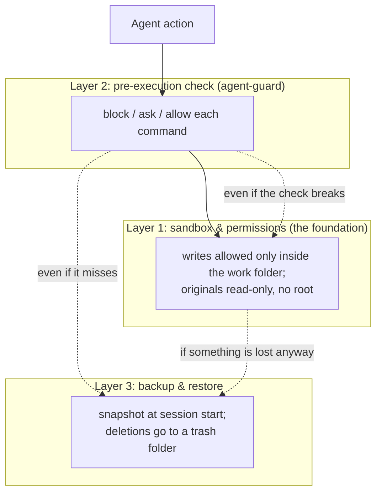

# agent-harness-starter-kit

A starter kit that lets **non-engineers start using AI coding agents safely**: one command installs a shared safety layer into any project for **Claude Code, Codex, Google Antigravity, or OpenCode**. 日本語の README（詳細版）は [README.ja.md](README.ja.md) です。

> **The one thing that matters**: decide what the AI must *not* be allowed to do before learning the tools. This kit installs a **3-layer defense** (permissions → pre-execution check → backup & restore) that behaves the same across all four harnesses. If the safety check breaks or is disabled, your important data still survives — verified in [the lab](#lab-results).

Requirements: Python 3.10+ (Windows / macOS / Linux). Standard library only — no pip installs.

---

## The accidents we prevent

Priority order:

1. **Critical** — loss of important data (originals, long-running work); leaks of secrets (keys, passwords, confidential files); damage to internal systems.
2. **High** — running malicious programs (piped downloads); unintended mass changes; prompt injection (instructions hidden in web pages or files that mislead the agent).
3. **Medium** — broken PC environment (OS settings, permissions); runaway loops and resource exhaustion.

## Four principles

- **A. Keep what matters out of reach.** Originals, secrets and OS settings live *outside* the agent's work folder. Protection by structure, not by asking nicely.
- **B. Don't block what you can undo.** Scratch-file deletions and builds run without interruption. Only irreversible operations and important files stop for review.
- **C. Humans decide only the irreversible parts.** Sending data out, editing originals, mass deletion — confirmation prompts appear only for these.
- **D. Never trust unknown code.** Download → inspect → run inside a container, never straight into the shell.

## Three layers of defense



| Layer | What it does | Where it comes from |
|---|---|---|
| 1. Sandbox & permissions | The agent can only write inside the work folder; originals are read-only | Claude Code `sandbox`, Codex `sandbox_mode`, Antigravity presets, OpenCode: OS permissions + containers |
| 2. Pre-execution check | One shared script (**agent-guard**) judges every command: block, ask, or allow | Hooks in each harness call `guard/agent_guard.py` |
| 3. Backup & restore | Session-start snapshots; a trash folder instead of deletion | Shared `checkpoint.py` and `trash.py` |

Reasons are always explained in plain language: what will happen, why it is risky, what could be lost, whether it is reversible, and a safer alternative.

## Areas A / B / C

| Area | Examples | Agent may… |
|---|---|---|
| **A — scratch** | `tmp/`, `build/`, `dist/`, `node_modules/`, `*.log` | Do anything, including delete (defaults in `policy.json`) |
| **B — work** | `src/`, `docs/`, project files | Edit freely (backed up first); **deletion asks a human** or goes to the trash folder |
| **C — protected** | originals, `.git/`, safety settings, everything outside the work folder | **Never write or delete** |

Keep originals *outside* the work folder in a read-only location; hand the agent only copies of what it needs.

## Install

```bash
git clone https://github.com/Sunwood-ai-labs/agent-harness-starter-kit
cd agent-harness-starter-kit

python install.py --project /path/to/my-project --tool claude   # or codex | antigravity | opencode | all
python install.py --project /path/to/my-project --tool claude --dry-run   # preview first
```

`install.py` copies `guard/` to `<project>/.agent-guard/` and writes the chosen harness's settings with absolute paths filled in. It never overwrites existing files (use `--force`, which keeps `.bak` copies) and never touches global config (`~/.claude`, `~/.codex`, `~/.gemini`, `~/.config/opencode`).

Per-tool walkthroughs: [claude-code/README.ja.md](claude-code/README.ja.md) · [codex/README.ja.md](codex/README.ja.md) · [antigravity/README.ja.md](antigravity/README.ja.md) · [opencode/README.ja.md](opencode/README.ja.md)

### Tool differences you must know

- **Codex hooks cannot open an approval prompt.** Returning `ask` counts as a hook *failure* and the call **continues anyway**, so this kit returns `deny` for everything that needs confirmation and the reason tells the agent to explain and let the human run it by hand.
- **OpenCode plugins cannot open an approval prompt either.** The plugin stops on both `deny` and `ask` and explains; interactive approval comes from OpenCode's own `permission` (`ask`) settings. Note `--auto` auto-approves `ask` but never overrides `deny`.
- **Claude Code (`ask`) and Antigravity (`force_ask`) can ask from the hook.**

Spec sources with URLs, verified 2026-11-06: [docs/spec-notes.md](docs/spec-notes.md).

## What hooks alone cannot prevent

The hook only sees command text. It cannot catch a deletion inside a Python script or a build tool, and a hook can itself fail or be disabled. That is why layer 1 (the agent simply cannot write outside the work folder — verified by running `rm` directly and watching the read-only filesystem reject it) and layer 3 (snapshots and trash restore) are the real guarantees. The lab reproduces each of these paths.

## Lab results

Accident scenarios are reproduced inside locked-down Podman containers (`lab/`) — deletion attempts with and without the hook, data exfiltration, guard tampering, guard breakage, runaway processes, and T3 Code serving. **20/20 accident tests, 6/6 host-side checks, and a real Claude Code agent e2e (6/6, `claude -p`: dangerous deletions stopped by hook ask/deny, scratch deletion allowed, sandbox active) plus a real OpenCode agent e2e (free hosted model) all passed.** Codex e2e remained unverified (account usage limit; re-run with `bash lab/e2e-codex.sh` after it resets — hook loading was observed up to the SessionStart hook). Enable the real-CLI e2e with `LAB_E2E_CLAUDE=1` / `LAB_E2E_CODEX=1` / `LAB_E2E_OPENCODE=1`; they auto-skip when no login credentials exist inside the container. Details and raw logs: [reports/lab-results.md](reports/lab-results.md).

> **Putting login credentials into the lab container** — only ever into that disposable, verification-only container (`harness-kit-*`); never copy, display, or log the files (the e2e scripts check for their *existence* only); delete the container afterwards (`podman rm -f <name>` or `lab/run-lab.sh --clean`) — note that re-running `run-lab.sh` also recreates the container and thus removes them; and be aware that token refresh by the agent may invalidate the host-side login (do not use shared accounts).

Run the unit tests anywhere: `python -m unittest discover -s tests -v` (29 tests, Windows & Linux CI).

## Repository layout

```
install.py            installer (copies templates into a project)
guard/                shared decision engine (stdlib-only Python)
  agent_guard.py      the pre-execution check
  trash.py            trash-folder move/restore instead of deletion
  checkpoint.py       session snapshots and restore
  policy.json         what counts as dangerous (areas A/B/C defaults)
claude-code/ codex/ antigravity/ opencode/   per-tool templates + README
tests/                unit tests for the guard
lab/                  Podman-based accident-reproduction lab
docs/spec-notes.md    verified spec notes with sources
reports/              lab logs and results
```

## License

MIT — see [LICENSE](LICENSE). This kit is one layer of defense, not a guarantee: keep originals outside the work folder and keep backups.
